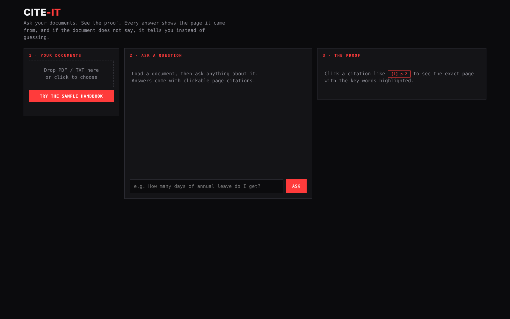
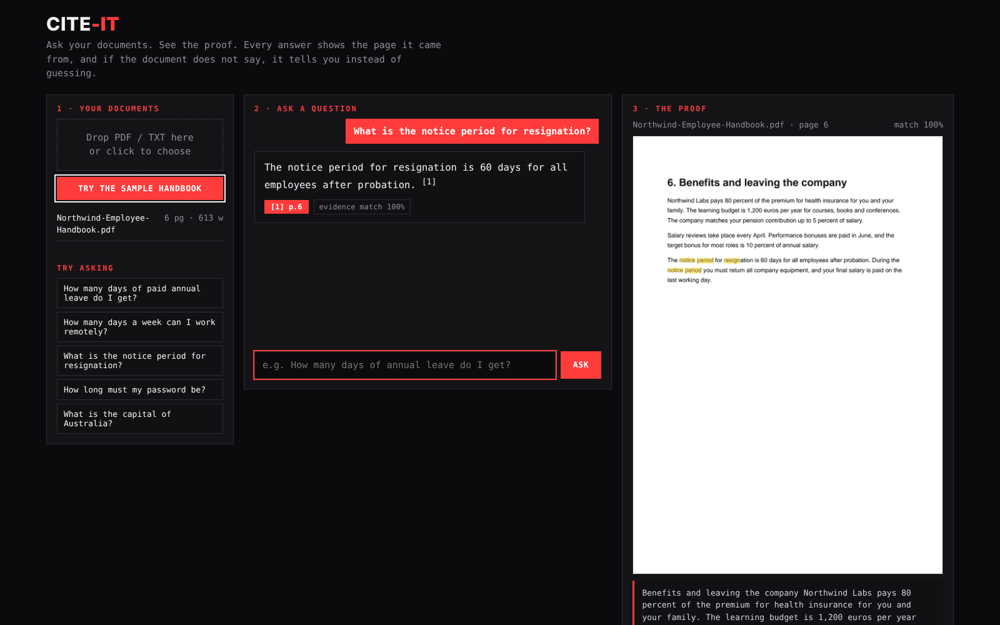
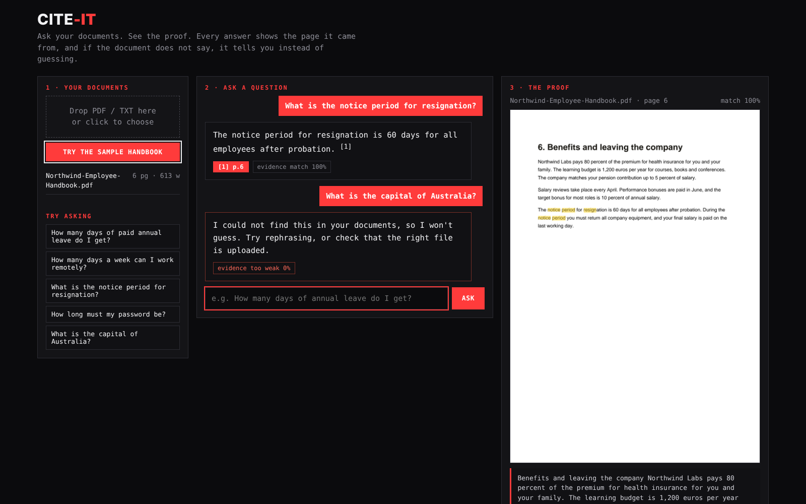

# Cite-It: Document Q&A with citations

Upload a PDF, ask a question, get an answer with `[n]` citations and the exact
page shown with the evidence highlighted. If the documents do not contain the
answer, Cite-It says so instead of guessing.

## Screenshots

| Start | Answer with citation | Refusal when not found |
|---|---|---|
|  |  |  |

## Run in VS Code

1. Open this folder in VS Code (`File > Open Folder`).
2. Open a terminal (`Ctrl + ~`) and create an environment:

   ```
   python -m venv .venv
   .venv\Scripts\activate        # Windows
   # source .venv/bin/activate   # Mac / Linux
   pip install -r requirements-dev.txt
   ```
3. Press `F5` (select "Cite-It: run app") or run:

   ```
   uvicorn app.main:app --reload --port 8000
   ```
4. Open http://localhost:8000 and click the sample handbook, or upload your own PDF.

Run tests: `pytest`

## How it works

1. **Read** the PDF text page by page (pypdf).
2. **Split** pages into small chunks.
3. **Search** with BM25 (keywords) and a TF-IDF + SVD dense index (meaning).
4. **Pick** the best chunks with Reciprocal Rank Fusion (RRF).
5. **Cite**: build an extractive answer with `[n]` markers; render the source page with highlights.

If the evidence is weak the answer is: "I could not find this in your documents, so I won't guess."

Optional: set `OLLAMA_MODEL` / `OLLAMA_URL` to let a local Ollama model phrase the answer from the retrieved passages.

## Project layout

```
app/        FastAPI app, retrieval, answer, page rendering
static/     single-page UI
data/       sample.pdf (6-page Northwind handbook)
tests/      pytest tests
Dockerfile, render.yaml   deploy on Render
```

Built by Karan More.
